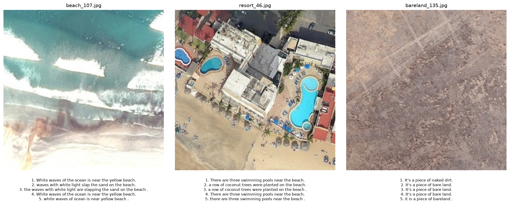
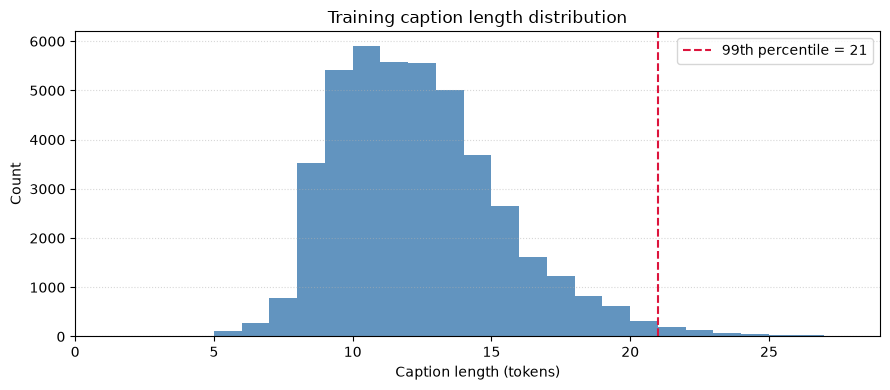
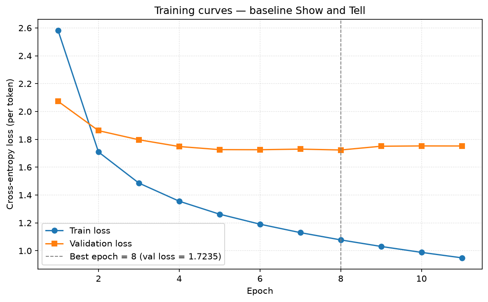
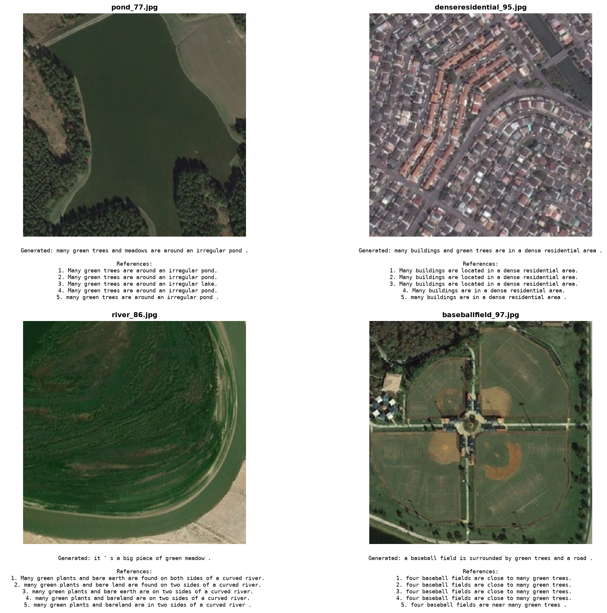
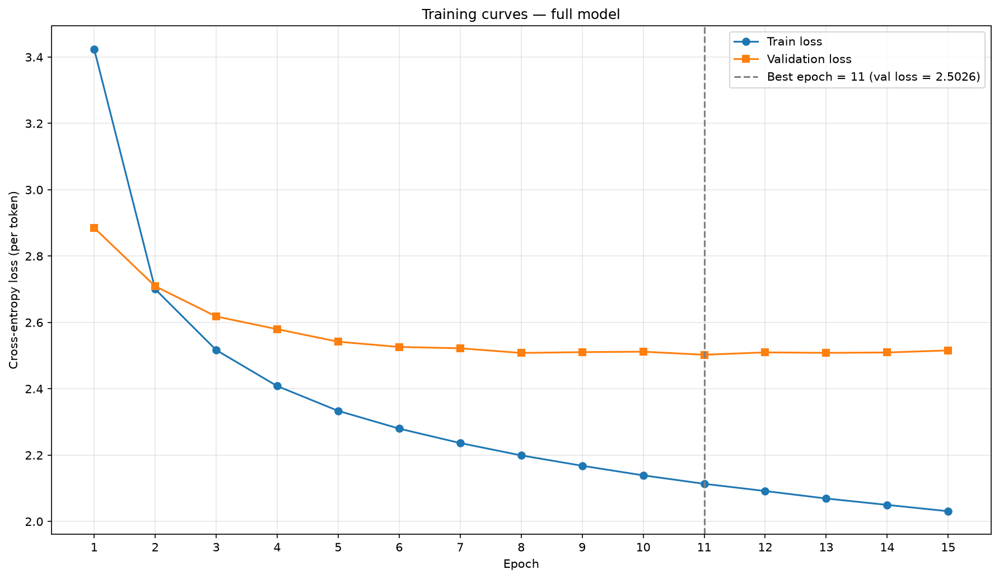
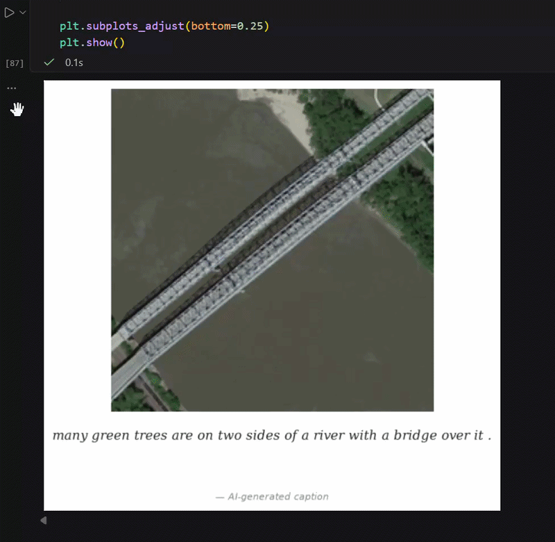

# Image Captioning su immagini satellitari (dataset RSICD)

**Università degli Studi di Catania** — Corso di Laurea Magistrale in Informatica 
**Corso:** Deep Learning Core Models and Methods 
**Docenti** Giovanni Maria Farinella e Francesco Ragusa 
**Anno Accademico:** 2025/2026 
**Studente:** Attilio Di Natale 
**Matricola:** 1000004030

---

## 1. Abstract

Il progetto affronta il problema dell'*image captioning* su immagini di telerilevamento: data un'immagine satellitare, generare automaticamente una sua descrizione in linguaggio naturale. Si utilizza il dataset RSICD (10.921 immagini, 5 caption di riferimento per immagine) con gli split ufficiali di training, validation e test.

La capacità di descrivere automaticamente il contenuto di immagini satellitari ha ricadute concrete in diversi ambiti applicativi: supporta il monitoraggio del territorio e dei cambiamenti dell'uso del suolo, agevola la gestione di emergenze ambientali (incendi, alluvioni, frane) producendo rapidamente sintesi testuali interpretabili, e rende più efficiente l'esplorazione di archivi di immagini di grandi dimensioni, consentendo ricerche su base semantica anziché per coordinate o metadati. Rispetto alla sola classificazione, una descrizione in linguaggio naturale cattura anche le relazioni tra gli oggetti presenti nella scena, informazione molto utile per analisti umani.

Come baseline è stata implementata in PyTorch un'architettura encoder–decoder in stile *Show and Tell*: una ResNet-50 pre-addestrata su ImageNet, congelata, come encoder e un decoder LSTM a un livello, addestrato con teacher forcing e decodifica greedy. Partendo dall'analisi delle curve di training della baseline, che mostrano un evidente overfitting, è stato progettato e addestrato da zero un modello migliorato che integra regolarizzazione (dropout, data augmentation, label smoothing, weight decay), fine-tuning dell'ultimo blocco residuo dell'encoder con learning rate differenziati e decodifica beam search.

Tutte le scelte di sviluppo sono state guidate dal validation set; il test set è stato utilizzato una sola volta, alla fine, per la valutazione dei due modelli finali. Sul test set il modello migliorato supera la baseline su tutte le metriche di valutazione considerate.

---

## 2. Introduzione

### Il problema: image captioning su immagini satellitari

L'image captioning si colloca all'intersezione tra computer vision ed elaborazione del linguaggio naturale. Il modello deve:

- estrarre una rappresentazione del contenuto visivo dell'immagine;
- produrre, a partire da essa, una frase grammaticalmente corretta e semanticamente coerente con la scena.

Il problema viene formulato come modellazione della probabilità di una sequenza di parole $S = (w_1, \dots, w_T)$ condizionata all'immagine $I$, fattorizzata in modo autoregressivo:

$$P(S \mid I) = \prod_{t=1}^{T} P(w_t \mid I, w_1, \dots, w_{t-1})$$

Il dominio del telerilevamento presenta difficoltà specifiche rispetto alle fotografie "da terra":

- **vista dall'alto**: le immagini non hanno un orientamento privilegiato;
- **scene complesse**: il contenuto è definito più dalla disposizione spaziale di molti oggetti piccoli (edifici, auto, alberi, piste) e dalle texture che da un singolo soggetto principale;
- **vocabolario di dominio ristretto ma tecnico**: termini legati a infrastrutture (*runway*, *viaduct*, *overpass*, *roundabout*), tipologie di uso del suolo (*dense/sparse residential area*, *industrial area*, *farmland*), impianti sportivi riconoscibili dall'alto per la loro forma (*baseball field*, *tennis court*) ed elementi naturali tipici del telerilevamento (*meadow*, *forest*, *beach*, *harbor*);
- **domain gap**: i backbone convoluzionali disponibili sono pre-addestrati su ImageNet, cioè su fotografie scattate da terra, non su immagini aeree.

  
  
<em>Vista aerea del centro storico di Firenze.</em>

### Obiettivi del progetto

1. Implementare una pipeline completa di image captioning in PyTorch: preparazione dei dati, vocabolario, `Dataset`/`DataLoader`, modello, training, generazione e valutazione.
2. Realizzare una baseline CNN–LSTM (*Show and Tell*) che funga da riferimento.
3. Analizzare il comportamento della baseline (curve di loss, overfitting, qualità delle caption) per motivare gli interventi successivi.
4. Addestrare un modello migliorato che integri tecniche di regolarizzazione, transfer learning con fine-tuning e una strategia di decoding più efficace.
5. Valutare i modelli con una metodologia corretta (split disgiunti, test set usato una sola volta) e con le metriche standard del captioning (BLEU, ROUGE-L, CIDEr).

### Panoramica della metodologia

Il lavoro è organizzato nelle seguenti fasi, che corrispondono alle sezioni del notebook `image_captioning_rsicd.ipynb`:

1. **Acquisizione** del dataset ed esportazione su disco in formato semplice (immagini JPEG + caption in JSON).
2. **Analisi esplorativa** delle caption e scelta della lunghezza massima delle sequenze.
3. **Tokenizzazione e vocabolario**, costruito esclusivamente sul training set.
4. **`Dataset` e `DataLoader`** PyTorch con padding dinamico delle sequenze.
5-6. **Baseline *Show and Tell***: training con teacher forcing ed early stopping sulla validation loss.
7. **Valutazione della baseline**: generazione autoregressiva greedy e calcolo delle metriche sul validation set.
8. **Modello con regolarizzazione e fine-tuning**: training da zero con tutte le tecniche migliorative, selezione del checkpoint sul validation set, decodifica beam search.
9. **Valutazione finale** di baseline e modello finale sul test set.

---

## 3. Dataset

### Descrizione

Si utilizza **RSICD** (*Remote Sensing Image Captioning Dataset*), un benchmark standard per il captioning di immagini satellitari introdotto da Lu et al. (2017). Il dataset è composto da **10.921 immagini aeree e satellitari** di dimensione **224×224 pixel**, raccolte da sorgenti pubbliche come Google Earth, Baidu Map, MapABC e Tianditu, che aggregano riprese satellitari e ortofoto aeree a diverse risoluzioni spaziali e provenienti da zone geografiche eterogenee.

Le immagini ritraggono **30 classi di scene** tipiche del telerilevamento — tra cui aeroporti, porti, stazioni ferroviarie, viadotti, aree residenziali dense e sparse, parchi, stadi, campi da baseball e da tennis, fiumi, laghi, foreste, deserti, terreni agricoli e zone industriali — e la classe di appartenenza è riconoscibile dal prefisso del nome del file (es. `airport_61.jpg`). Ogni immagine è associata a **5 caption in inglese** scritte da annotatori umani diversi, per un totale di 54.605 descrizioni.

Composizione degli split ufficiali:

| Split | Immagini | Caption (immagini × 5) |
|---|---:|---:|
| Training | 8.734 | 43.670 |
| Validation | 1.094 | 5.470 |
| Test | 1.093 | 5.465 |
| **Totale** | **10.921** | **54.605** |

Dall'ispezione dei dati emergono due caratteristiche rilevanti per l'addestramento e la valutazione:

- **ridondanza delle reference**: per molte immagini le 5 caption sono quasi identiche (es. `airport_1.jpg`: *"Many planes are parked next to a long building in an airport"* ripetuta con minime variazioni);
- **eterogeneità delle reference**: per altre immagini le caption differiscono molto per lunghezza e contenuto (es. `airport_61.jpg`, dove si passa da una descrizione dettagliata di piste e rettangoli di terreno a *"a brown ground divided by the grey runway"*).

  
  
<em>Esempi rappresentativi del dataset RSICD.</em>

### Acquisizione

Il dataset originale è distribuito dagli autori su **GitHub** (`201528014227051/RSICD_optimal`), dove sono disponibili le immagini e il file JSON con le annotazioni e gli split ufficiali. Per praticità si è scelto di scaricarlo dall'**Hugging Face Hub** (repository `arampacha/rsicd`), che redistribuisce lo stesso dataset in un formato immediatamente leggibile dalla libreria `datasets`, evitando il download manuale e la gestione dei percorsi relativi presenti nel JSON originale.

Lo script one-off `scripts/prepare_data.py` esporta ciascuno split in un formato semplice e ispezionabile:

<pre style="background:#1e1e1e; color:#f8f8f2; padding:12px; border-radius:6px; font-family:monospace;">
data/rsicd/
├── images/
│   ├── train/   (8.734 file .jpg)
│   ├── valid/   (1.094 file .jpg)
│   └── test/    (1.093 file .jpg)
└── captions/
    ├── train.json
    ├── valid.json
    └── test.json
</pre>

- Le immagini sono salvate in JPEG (qualità 95).
- Ogni file JSON contiene una lista di record `{"filename": ..., "captions": [5 stringhe]}`.
- I nomi dei file sono stati normalizzati rimuovendo il prefisso di percorso presente nel campo originale (`rsicd_images/...`).
- È stato verificato che non esistano nomi di file in comune tra gli split (sovrapposizione train/valid, train/test e valid/test pari a 0).

Dopo l'esportazione la dipendenza da `datasets` è stata rimossa: il notebook legge esclusivamente i file JPEG e JSON su disco tramite la funzione `load_split`. La cartella `data/` è esclusa dal versionamento e si rigenera eseguendo lo script.

---

## 4. Preprocessing

### Tokenizzazione

Ogni caption viene convertita in minuscolo, la punteggiatura viene separata dalle parole tramite espressione regolare e il testo viene diviso sugli spazi:

<pre style="background:#1e1e1e; color:#f8f8f2; padding:12px; border-radius:6px; font-family:monospace;">
"Many aircraft are parked next to a long building in an airport."
→ ['many', 'aircraft', 'are', 'parked', 'next', 'to', 'a', 'long', 'building', 'in', 'an', 'airport', '.']
</pre>

Statistiche sulle 43.670 caption di training (in token):

| min | max | media | mediana | p90 | p95 | p99 |
|---:|---:|---:|---:|---:|---:|---:|
| 1 | 165 | 11.93 | 12 | 16 | 18 | 21 |

La distribuzione è concentrata tra 8 e 16 token, con una coda lunga di poche caption anomale. È stato scelto **`MAX_LEN = 22`**: 20 token di contenuto più `<bos>` ed `<eos>`. Con questa soglia vengono troncate 563 caption su 43.670 (**1.29%**), evitando di dimensionare il padding sugli outlier.

### Vocabolario

Il vocabolario è costruito **solo sulle caption di training**, per evitare qualsiasi fuga di informazione dagli split di valutazione. Il training set contiene 2.829 parole distinte per 521.004 occorrenze totali. Le parole rare vengono scartate con una soglia minima di frequenza `MIN_FREQ`. Di seguito, da un lato le 20 parole più frequenti nel training set e dall'altro l'effetto della soglia `MIN_FREQ` sulla dimensione del vocabolario e sulla copertura delle occorrenze:

**Top 20 parole più frequenti**

| # | Parola | Occorrenze |
|---:|:---|---:|
| 1 | `.` | 43.832 |
| 2 | `a` | 41.145 |
| 3 | `are` | 25.505 |
| 4 | `green` | 21.115 |
| 5 | `many` | 18.821 |
| 6 | `trees` | 17.371 |
| 7 | `and` | 16.649 |
| 8 | `of` | 15.116 |
| 9 | `the` | 14.875 |
| 10 | `in` | 14.872 |
| 11 | `buildings` | 14.077 |
| 12 | `is` | 11.592 |
| 13 | `some` | 10.297 |
| 14 | `with` | 9.177 |
| 15 | `near` | 6.862 |
| 16 | `on` | 6.086 |
| 17 | `several` | 5.888 |
| 18 | `two` | 5.377 |
| 19 | `to` | 5.267 |
| 20 | `area` | 5.065 |

**Dimensione del vocabolario vs. `MIN_FREQ`**

| `MIN_FREQ` | Parole | Copertura occorrenze |
|---:|---:|---:|
| 1 | 2.829 | 100.00% |
| 2 | 1.832 | 99.81% |
| 3 | 1.442 | 99.66% |
| 5 | 1.103 | 99.44% |
| 10 | 804 | 99.06% |
| 20 | 583 | 98.48% |

La *top 20* mette in evidenza due aspetti del dominio: la forte presenza di articoli e connettivi (`a`, `the`, `of`, `in`, `and`), tipica di ogni corpus in lingua naturale, e la rilevanza di termini legati al telerilevamento vegetazionale e urbano (`green`, `trees`, `buildings`, `area`), che riflettono il contenuto prevalente delle scene RSICD. La tabella delle soglie mostra invece una tipica **distribuzione a coda lunga**: oltre un terzo delle parole del training compare una sola volta, e già scartando le parole con meno di 5 occorrenze si riduce il vocabolario del 61% perdendo solo lo 0.56% delle occorrenze totali.

Con **`MIN_FREQ = 5`** si mantengono 1.103 parole, che coprono il 99.44% delle occorrenze. A queste si aggiungono 4 token speciali, per un **vocabolario di 1.107 token**:

| Token | Indice | Funzione |
|---|---:|---|
| `<pad>` | 0 | riempimento per uniformare le lunghezze nel batch |
| `<bos>` | 1 | inizio sequenza |
| `<eos>` | 2 | fine sequenza |
| `<unk>` | 3 | parola fuori vocabolario |

Le parole sono indicizzate in ordine di frequenza decrescente. Due funzioni gestiscono la conversione:

- `encode`: tokenizza, tronca a `MAX_LEN − 2` token, mappa le parole in indici (`<unk>` se assenti) e aggiunge `<bos>`/`<eos>`;
- `decode`: converte gli indici in testo ignorando `<pad>` e `<bos>` e fermandosi al primo `<eos>`.

### Dataset e DataLoader

Le immagini RSICD sono già distribuite a risoluzione fissa 224×224 pixel, quindi la trasformazione iniziale di `Resize(224)` risulta nella pratica un *no-op* su tutti i campioni del dataset. È stata comunque mantenuta nella pipeline come salvaguardia difensiva: garantisce che, nel caso in cui venissero introdotte in futuro immagini a risoluzione diversa (ad esempio aggiungendo campioni esterni al dataset o estendendo il modello ad altri benchmark di telerilevamento), il formato richiesto dall'encoder ResNet-50 resti sempre garantito. Al netto di questa cautela, le operazioni effettivamente attive sulle immagini sono due:

1. **convertita da immagine PIL a tensore PyTorch** con `transforms.ToTensor()`, che riordina gli assi nel layout `(C, H, W)` richiesto dai layer convoluzionali e riscala i valori dei pixel dall'intervallo intero `[0, 255]` al float `[0, 1]`;
2. **normalizzata canale per canale** con media `[0.485, 0.456, 0.406]` e deviazione standard `[0.229, 0.224, 0.225]`, che sono le statistiche calcolate da ImageNet. Questa normalizzazione è essenziale perché la ResNet-50 usata come encoder è stata pre-addestrata su ImageNet con la stessa normalizzazione: fornirle input con una distribuzione diversa farebbe cadere l'ipotesi su cui si basa il transfer learning, degradando le feature estratte.

La classe `RSICDDataset` estende `torch.utils.data.Dataset` e implementa l'interfaccia standard di PyTorch (`__len__` e `__getitem__`). Riceve in input lo split (lista di record `{"filename", "captions"}`), il vocabolario, la cartella delle immagini e la trasformazione da applicare, e si occupa di:

- **esplodere le coppie immagine–caption**: ogni immagine ha 5 caption di riferimento, e ciascuna è trattata come esempio indipendente di training. L'indice `idx` passato a `__getitem__` viene quindi mappato sull'immagine `idx // 5` e sulla sua caption `idx % 5`. In questo modo il training set effettivo passa da 8.734 immagini a **43.670 campioni**, offrendo al modello più varianti linguistiche per la stessa scena visiva e migliorando la generalizzazione del decoder;
- **caricare l'immagine su richiesta**: il file JPEG viene letto da disco con PIL, convertito in RGB e passato alla trasformazione descritta sopra. Il caricamento *lazy* evita di tenere in memoria l'intero dataset e si presta bene al caricamento parallelo del `DataLoader`;
- **codificare la caption**: la stringa viene passata a `encode`, che restituisce un tensore di indici di lunghezza variabile (fino a `MAX_LEN`), già arricchito dei token `<bos>` e `<eos>`.

La restituzione è quindi una coppia `(immagine, caption_ids)` con l'immagine come tensore `(3, 224, 224)` e la caption come tensore `(L,)` di interi.

Poiché le caption di un batch hanno lunghezze diverse, è necessaria una `collate_fn` personalizzata che impila le immagini con `torch.stack` e applica `pad_sequence` alle caption usando `<pad>` come valore di riempimento, uniformando così tutte le sequenze alla lunghezza massima del batch. Il `DataLoader` è configurato con `BATCH_SIZE = 32`, `shuffle = True` solo sul training set (validation e test restano in ordine deterministico per riproducibilità) e `num_workers = 0`. Ne risultano 1.365 batch di training e 171 batch per validation e test. Un batch ha forma `(32, 3, 224, 224)` per le immagini e `(32, L)` per le caption, con `L ≤ 22`.

---

## 5. Metodologia: architettura e tecnologie

### Architettura della baseline (*Show and Tell*)

L'architettura adottata segue lo schema *Show and Tell* (Vinyals et al., 2015): un encoder convoluzionale estrae una rappresentazione globale dell'immagine, che viene usata per inizializzare lo stato di un decoder ricorrente incaricato di generare la caption parola per parola. I due moduli sono poi assemblati nella classe `ShowAndTell`, che espone un'interfaccia unica verso il resto del codice (`forward` per il training e `generate` per l'inferenza) mantenendo training loop e valutazione agnostici rispetto ai dettagli interni dei sotto-moduli. Quella descritta in questa sezione è la **versione di partenza** del modello, pensata come riferimento essenziale per valutare poi l'impatto delle scelte di regolarizzazione, fine-tuning e data augmentation: il **modello finale**, costruito a partire da questa baseline per migliorarne le prestazioni, è descritto nella sezione 8.

**Encoder (`EncoderCNN`).** L'encoder ha il compito di produrre una rappresentazione vettoriale compatta della scena satellitare. Come backbone si utilizza **ResNet-50** con pesi pre-addestrati `IMAGENET1K_V2`, scelta per il buon compromesso tra capacità rappresentativa e costo computazionale. Il layer di classificazione finale (`fc`) viene sostituito da un'identità, in modo che l'output della rete sia il vettore di **2048 feature** prodotto dal global average pooling: una rappresentazione globale e densa dell'immagine, già distillata in forma utile al condizionamento. Tutti i parametri del backbone sono **congelati**. A valle della ResNet, un layer lineare addestrabile **2048 → 512** proietta le feature nella dimensione dello stato nascosto del decoder, fungendo da ponte tra il mondo visivo e quello linguistico.

**Decoder (`DecoderLSTM`).** Il decoder è una rete ricorrente che genera la caption un token alla volta. Riceve in input gli indici dei token della sequenza, che vengono trasformati in rappresentazioni dense tramite un layer di `Embedding(1107, 256)` con `padding_idx = 0` (così da ignorare i token di padding nel calcolo del gradiente). Gli embedding alimentano una **LSTM a 1 livello** con dimensione di input 256 e stato nascosto 512, che modella le dipendenze sequenziali tra le parole. Lo stato nascosto della LSTM a ogni passo viene infine proiettato sul vocabolario tramite un layer lineare **512 → 1107**, che produce i logit da cui si ricava la distribuzione di probabilità sulle parole successive.

I due moduli vengono messi in comunicazione nel seguente modo: il vettore proiettato dell'immagine viene usato come stato nascosto iniziale `h₀` della LSTM, mentre lo stato di cella `c₀` è inizializzato a zero; l'immagine entra quindi nel decoder una sola volta, all'inizio della sequenza, e da lì in avanti la generazione procede sulla base dei soli token linguistici. In fase di training si adotta la strategia del **teacher forcing**: il decoder riceve in input la caption senza l'ultimo token (`caption[:, :-1]`, a partire da `<bos>`) e deve predire la stessa caption traslata di una posizione (`caption[:, 1:]`, fino a `<eos>`), così che a ogni passo l'input sia la parola *vera* del riferimento e non quella generata al passo precedente. Per un batch di 32 caption di lunghezza 22 l'output ha quindi forma `(32, 21, 1107)`.

**Parametri.**

| | Parametri |
|---|---:|
| Totali | 26.985.363 |
| Addestrabili | 3.477.331 (12.89%) |
| — di cui layer di proiezione | 1.049.088 |
| — di cui decoder | 2.428.243 |
| Congelati (ResNet-50) | 23.508.032 |

**Generazione delle caption**

In inferenza la caption viene generata in modo **autoregressivo**: si parte da `<bos>`, con stato iniziale ottenuto dall'immagine, e a ogni passo il token predetto viene reinserito come input del passo successivo, fino a che non viene prodotto `<eos>` o si raggiungono `MAX_LEN − 1` passi.

La strategia di decodifica usata dalla baseline è il **greedy decoding** (metodo `generate` del decoder): a ogni passo si sceglie il token con il logit più alto, cioè la parola localmente più probabile data l'immagine e la storia generata fino a quel momento. È la strategia più semplice e veloce, ma non garantisce di trovare la sequenza globalmente ottima, perché una scelta localmente migliore può portare a continuazioni complessivamente peggiori. L'implementazione lavora su batch e mantiene una maschera `finished` per gestire correttamente sequenze dello stesso batch che terminano in istanti diversi: una volta che una sequenza ha prodotto `<eos>`, i token successivi vengono forzati a `<pad>` e non contribuiscono più al risultato finale.

Nel modello finale (sezione 8) verrà introdotta una strategia di decodifica più sofisticata, pensata per esplorare meglio lo spazio delle sequenze possibili.

### Tecnologie e ambiente

- **Linguaggio:** Python 3.12, in ambiente virtuale dedicato.
- **Deep learning:** PyTorch 2.5.1 e torchvision 0.20.1 (build CUDA 12.1); ResNet-50 da `torchvision.models`.
- **Valutazione:** NLTK (`corpus_bleu`) per BLEU; `pycocoevalcap` per CIDEr e ROUGE-L.
- **Monitoraggio:** TensorBoard (`SummaryWriter`, log in `runs/<nome_run>`).
- **Supporto:** NumPy, Matplotlib, Pillow, tqdm.
- **Sviluppo:** Jupyter Notebook in VS Code; versionamento con Git/GitHub.
- **Hardware:** GPU NVIDIA GeForce RTX 3070 Ti.
- **Riproducibilità:** seed fisso (`SEED = 42`) per `random`, NumPy e PyTorch (CPU e CUDA).

---

## 6. Training

### Funzione obiettivo e teacher forcing

Il training della **baseline** adotta la strategia del **teacher forcing**: a ogni passo il decoder riceve in input il token corretto della caption di riferimento, non la propria predizione precedente. Questo permette di elaborare l'intera caption in un'unica forward pass della LSTM — e quindi di parallelizzare il calcolo del gradiente su tutti i passi temporali — e mantiene stabile l'addestramento anche nelle prime epoche, quando le predizioni autoregressive del decoder sarebbero di qualità troppo bassa per servire da input affidabile. Il prezzo è una discrepanza strutturale tra training e inferenza nota come *exposure bias*: in generazione il modello deve condizionarsi sulle proprie predizioni, che non ha mai visto in training.

La **funzione obiettivo** è la **cross-entropy per token** con `ignore_index = <pad>`, scelta per due motivi. In primo luogo è la funzione di loss standard per problemi di classificazione multiclasse — e il task del decoder, formalmente, è esattamente una classificazione: a ogni passo deve scegliere la parola successiva tra le 1.107 possibili del vocabolario. In secondo luogo, essendo derivabile dalla likelihood della sequenza di riferimento sotto il modello, minimizzarla equivale a massimizzare la probabilità che il modello assegna alle caption corrette: è quindi la scelta canonica per modelli generativi autoregressivi. Il parametro `ignore_index = <pad>` è cruciale: senza di esso le posizioni riempite con `<pad>` per uniformare le lunghezze del batch contribuirebbero al gradiente, premiando il modello per aver predetto `<pad>` dopo `<eos>` e introducendo un bias sistematico verso le sequenze corte. Per ogni epoca la loss media è calcolata pesando il contributo di ciascun batch per il numero di token non di padding, in modo da ottenere una **vera media per token** sull'intero split, invece di una media di medie che darebbe peso improprio ai batch con caption più corte.

Loss di training e validation sono registrate a ogni epoca su **TensorBoard**, lo strumento di logging standard dell'ecosistema PyTorch.

### Procedura

A ogni epoca:

1. `train_one_epoch`: modello in modalità `train`, forward, backward e aggiornamento dei pesi su tutto il training set;
2. `evaluate`: calcolo della loss sul validation set, senza gradienti, con modello in modalità `eval`;
3. salvataggio del checkpoint (epoca, `state_dict`, validation loss) se la validation loss migliora;
4. **early stopping** se la validation loss non migliora per `PATIENCE` epoche consecutive.

Al termine viene ricaricato il checkpoint con la validation loss minima, in modo da operare in inferenza con lo stato del modello che ha generalizzato meglio.

### Training della baseline

| Iperparametro | Valore |
|---|---|
| Ottimizzatore | Adam, `lr = 1e-4` (solo parametri addestrabili) |
| Loss | Cross-entropy, `ignore_index = <pad>` |
| Batch size | 32 |
| Epoche massime | 15 |
| Patience | 3 |

**Learning rate (`1e-4`).** La scelta di `1e-4` segue il valore considerato in letteratura come il **default più sicuro per l'ottimizzatore Adam** su modelli encoder–decoder di dimensione medio-piccola. Si tratta di un learning rate abbastanza alto da garantire una discesa rapida nelle prime epoche — il training raggiunge un plateau sul validation già intorno all'epoca 5 — ma non così aggressivo da compromettere la stabilità dell'ottimizzazione o da indurre oscillazioni. Vale la pena notare che il learning rate è applicato **solo ai parametri addestrabili** (layer di proiezione e decoder, come indicato nella tabella dei parametri della sezione 5), mentre i pesi congelati della ResNet non ricevono alcun aggiornamento.

**Numero massimo di epoche (15).** Il cap di 15 epoche è stato scelto come **limite superiore difensivo**, non come target da raggiungere. L'idea è stabilire un budget computazionale ragionevole (circa 20.000 iterazioni di SGD su un dataset di 43.670 campioni con batch size 32) sufficiente a vedere la curva di validation raggiungere un plateau e, se mai, iniziare a risalire — segno che non c'è più niente da imparare che si traduca in migliore generalizzazione. La decisione effettiva di quando fermarsi è delegata al meccanismo di **early stopping**, non al cap: nella pratica il training si è fermato all'epoca 11, confermando che 15 era un valore sufficientemente ampio. L' early stopping è il meccanismo che interrompe automaticamente il training quando la validation loss smette di migliorare, prevenendo overfitting e sprechi di tempo di calcolo. Il parametro `PATIENCE = 3` definisce la **tolleranza**: il training continua finché la validation loss migliora, e viene interrotto solo dopo **3 epoche consecutive** senza miglioramento rispetto al minimo registrato. La scelta di 3 è un compromesso ragionato tra due estremi: una patience troppo bassa (1 o 2) rischierebbe di interrompere il training per oscillazioni casuali della validation loss, perdendo potenziali miglioramenti successivi; una patience troppo alta (5 o più) sprecherebbe risorse continuando a girare quando il modello sta già overfittando senza speranza di recupero.  Il checkpoint migliore è quello dell'**epoca 8** con validation loss **1.7235**.

  

Il grafico mostra l'andamento della cross-entropy per token su training e validation set durante il training della baseline. La **training loss** (curva blu) scende con continuità da 2.5815 all'epoca 1 fino a 0.9493 all'epoca 11, con pendenza decrescente che indica una convergenza regolare dell'ottimizzatore. La **validation loss** (curva arancione) segue invece un pattern completamente diverso: scende rapidamente nelle prime quattro epoche (da 2.07 a 1.75), rallenta tra la quarta e la quinta, raggiunge il **minimo 1.7235 all'epoca 8** (evidenziata dalla linea tratteggiata grigia) e dopo quel punto inizia a **risalire leggermente** stabilizzandosi intorno a 1.75. Il **divario crescente tra le due curve** — da 0.21 all'epoca 1 a circa 0.80 all'epoca 11 — è la firma visiva classica dell'**overfitting**: il modello continua a migliorare le sue predizioni sui dati di training senza che questo si traduca in migliori capacità di generalizzazione sul validation set.

---

## 7. Metriche di valutazione 

### Protocollo di valutazione

La valutazione della baseline viene effettuata **sul validation set**, che conta 1.094 immagini ciascuna con 5 caption di riferimento scritte da annotatori umani. Il test set resta volutamente intoccato in questa fase e verrà utilizzato una sola volta nella sezione 9 per la valutazione finale, in modo da evitare qualsiasi forma di selezione implicita delle scelte di modello sul test.

Il modello valutato è quello corrispondente al **checkpoint migliore salvato durante il training**, ovvero lo stato dei pesi dell'epoca 8, in cui la validation loss ha raggiunto il minimo di 1.7235 (sezione 6).

Per ciascuna immagine del validation set il modello genera **una sola caption** in modo autoregressivo. La caption generata viene poi confrontata, tramite le metriche descritte sotto, con tutte e **5 le reference** disponibili per quell'immagine.

È importante notare che la cross-entropy per token usata come funzione obiettivo in training **non viene usata come misura di qualità delle caption**: la loss misura la capacità del modello di predire il token successivo quando riceve in input il contesto corretto (teacher forcing), non la qualità di una frase generata in modo autonomo. Due modelli con la stessa validation loss possono generare caption di qualità molto diversa in inferenza, perché la discrepanza tra training e generazione (*exposure bias*) si fa sentire solo in autoregressivo. Per questo motivo le metriche descritte di seguito sono calcolate direttamente sulle caption generate.

### Le metriche usate

Nel captioning di immagini non esiste un'unica metrica che catturi tutti gli aspetti della qualità di una frase generata, e per questa ragione la pratica consolidata consiste nel riportare un **insieme di metriche complementari**, ciascuna delle quali misura una dimensione diversa della vicinanza tra ipotesi e reference. Nel nostro protocollo utilizziamo le sei metriche standard adottate dai principali benchmark di captioning: BLEU-1, BLEU-2, BLEU-3, BLEU-4, ROUGE-L e CIDEr.

**BLEU-n** (*Bilingual Evaluation Understudy*) è la metrica più nota per la valutazione di sistemi di generazione testuale, originariamente proposta nel 2002 per la traduzione automatica e poi adottata universalmente nel captioning. L'idea è semplice: si misura la **precisione degli n-gram** dell'ipotesi, cioè la frazione di sequenze di `n` parole consecutive della caption generata che appaiono anche in almeno una delle reference. BLEU-1 lavora sulle singole parole (unigrammi) e misura essenzialmente il vocabolario; BLEU-2 sui bigrammi e cattura le collocazioni ("green trees", "many buildings"); BLEU-3 sui trigrammi e si avvicina alla sintassi locale; BLEU-4 sui 4-grammi ed è la metrica più severa, quella più comunemente riportata nei paper come indicatore sintetico della qualità complessiva. Tutte le varianti di BLEU variano tra 0 e 1.

**ROUGE-L** (*Recall-Oriented Understudy for Gisting Evaluation, Longest common subsequence*) adotta un approccio diverso dalle BLEU: invece di contare n-gram contigui, misura la lunghezza della **più lunga sotto-sequenza comune** (*Longest Common Subsequence*, LCS) tra ipotesi e reference, cioè la più lunga sequenza di parole che compare nello stesso ordine in entrambe le frasi anche se non necessariamente in posizioni consecutive. Varia anch'essa tra 0 e 1.

**CIDEr** (*Consensus-based Image Description Evaluation*) è una metrica specificamente progettata per il captioning di immagini. Rappresenta ipotesi e reference come **vettori TF-IDF** di n-gram (per `n = 1…4`) e ne calcola la **similarità coseno**: gli n-gram frequenti in tutte le reference del corpus (parole generiche come "the", "a", "is") pesano poco, mentre quelli distintivi e specifici del dominio (parole come "runway", "viaduct") pesano molto. In pratica CIDEr premia il modello quando usa correttamente il vocabolario discriminante della scena, e lo penalizza quando si limita a produrre frasi generiche e vaghe. Due aspetti rendono CIDEr diversa dalle altre metriche: in primo luogo **non è normalizzata nell'intervallo [0, 1]** ma tipicamente assume valori tra 0 e circa 3, con rari picchi oltre questa soglia; in secondo luogo il **peso IDF viene calcolato sulle reference dello split valutato**, il che implica che i valori di CIDEr non sono direttamente confrontabili tra split diversi.

### Risultati della baseline sul validation set

I risultati della baseline sono riportati nella tabella seguente.

| Metrica | Valore | Interpretazione |
|---|---:|---|
| BLEU-1 | 0.7263 | ~73% delle parole generate compare nelle reference |
| BLEU-2 | 0.5879 | ~59% delle coppie di parole consecutive combacia |
| BLEU-3 | 0.4909 | ~49% delle triplette di parole consecutive combacia |
| BLEU-4 | 0.4186 | ~42% delle quadruplette di parole consecutive combacia |
| ROUGE-L | 0.6545 | buona copertura strutturale delle reference |
| CIDEr | 2.0663 | uso consistente del vocabolario di dominio |

In valore assoluto si tratta di risultati **solidi**: BLEU-4 sopra 0.40 indica che il modello produce già frasi grammaticalmente ben formate e semanticamente aderenti alle reference, e CIDEr sopra 2.0 segnala che il vocabolario specialistico del telerilevamento (termini come *runway*, *baseball field*, *residential area*, *viaduct*) viene usato in modo appropriato. Il pattern dei valori di BLEU, che decresce in modo regolare da BLEU-1 a BLEU-4 senza crolli bruschi, è un buon segnale sulla coerenza interna delle caption generate: se la precisione dei 4-gram fosse molto più bassa di quella degli unigrammi, significherebbe che il modello azzecca le parole giuste ma le mette insieme in modo scoordinato, cosa che qui non avviene.

Questi valori sono un punto di partenza, non il massimo raggiungibile, e l’obiettivo è spingere ulteriormente le prestazioni del modello. La baseline soffre di due limiti strutturali. Il primo è l'**assenza di regolarizzazione**: dopo l'epoca 8 la training loss continua a scendere ma la validation loss risale, segno che il modello sta memorizzando il training set invece di generalizzare. Il secondo riguarda le **feature dell'encoder congelate**: la ResNet-50 estrae rappresentazioni ottimizzate per ImageNet, non per scene satellitari viste dall'alto. 

La prossima sezione descrive il **modello finale**, costruito per affrontare entrambe le questioni.

### Analisi qualitativa delle caption generate

Oltre ai valori numerici, è utile osservare direttamente alcune caption generate dalla baseline per capire cosa il modello sa fare e dove invece sbaglia. La figura seguente mostra 4 immagini del validation set scelte in modo casuale, affiancate alla caption generata dalla baseline e alle 5 reference umane.

  

Il modello riconosce correttamente la categoria della scena in tutti i casi e produce frasi grammaticalmente ben formate. Per `pond_77.jpg` e `denseresidential_95.jpg` le caption generate ricalcano quasi letteralmente le reference e usano con proprietà il vocabolario di dominio (*"irregular pond"*, *"dense residential area"*).

Gli altri due esempi evidenziano invece le debolezze del modello. Per `river_86.jpg` la baseline descrive la scena come *"a big piece of green meadow"*, lasciandosi dominare dal colore prevalente e perdendo il fiume curvilineo che tutte le reference menzionano. Per `baseballfield_97.jpg` genera *"a baseball field is surrounded by green trees and a road"*, sbagliando il numero di campi (le reference ne contano quattro) e inserendo una strada non presente — una tipica *allucinazione*.

---

## 8. Modello finale

### Motivazione

La valutazione della baseline ha evidenziato due limiti chiari. Dal lato dell'ottimizzazione, le curve di loss hanno mostrato un chiaro overfitting, dal lato della rappresentazione visiva, l'uso di una ResNet-50 interamente congelata costringe il decoder a lavorare con feature pre-addestrate su ImageNet — ottimizzate per fotografie di oggetti quotidiani — anziché su feature specializzate per il dominio satellitare. Al tempo stesso, i risultati della baseline sul validation set rappresentano un punto di partenza solido ma lasciano margine di miglioramento. Il modello finale nasce dall'intento di aggredire entrambi i problemi contemporaneamente, integrando in una singola configurazione un insieme coordinato di tecniche di regolarizzazione, un fine-tuning parziale dell'encoder e una strategia di decodifica più sofisticata.

### Tecniche applicate

Il modello completo mantiene l'architettura *Show and Tell* della baseline — stesso encoder ResNet-50, stesso decoder LSTM a un livello, stessa dimensione dello stato nascosto — e vi aggiunge sei interventi che agiscono su piani diversi del training e dell'inferenza.

1. **Dropout** (p=0.3) inserito in due punti del decoder: subito dopo l'embedding e subito dopo la LSTM, prima del layer finale. Questo impedisce al modello di dipendere da pochi neuroni specifici e lo costringe a distribuire la rappresentazione su più unità, migliorando la generalizzazione. In inferenza il dropout è automaticamente disattivato.
2. **Data augmentation** sulle immagini di training (flip orizzontali e verticali, rotazioni di 90°, 180° e 270°). L'augmentation è applicata **online** nella pipeline del `Dataset`: a ogni epoca ciascuna immagine viene vista in una variante potenzialmente diversa, aumentando di fatto la varietà osservata dal modello senza modificare la dimensione nominale del dataset.
3. **Label smoothing** (ε=0.1) nella cross-entropy — regolarizzazione sui target. Invece di addestrare il modello a produrre distribuzioni di probabilità one-hot (1 per il token corretto, 0 per tutti gli altri), si "spalma" il 10% della massa di probabilità uniformemente sugli altri token del vocabolario. Questo scoraggia predizioni eccessivamente confidenti e migliora la calibrazione del modello.
4. **Weight decay** (1e-5) nell'ottimizzatore Adam — regolarizzazione L2 classica sui parametri, che penalizza pesi di grande magnitudine durante l'aggiornamento.
5. **Fine-tuning dell'encoder** limitato all'ultimo blocco residuale (`layer4`) della ResNet-50. La scelta di scongelare solo questo blocco e non l'intera rete nasce dalla distinzione tra feature a basso e alto livello: i layer iniziali (`layer1`, `layer2`, `layer3`) imparano feature generiche (bordi, texture, pattern elementari) che valgono su qualunque immagine, mentre `layer4` cattura feature semantiche di alto livello fortemente legate alle classi di ImageNet, e sono proprio quelle che meno si trasferiscono bene al dominio satellitare. Sbloccare `layer4` consente di specializzarle sul captioning di scene aeree senza distruggere la base pre-addestrata preservata nei layer inferiori. In termini numerici, questa scelta porta i parametri addestrabili da 3.5M (13% del totale) a 18.4M (68%).
6. **Beam search** (K=5, length penalty α=0.7) in inferenza, al posto del greedy decoding. Mentre il greedy sceglie a ogni passo il token localmente più probabile, la beam search mantiene attive le K sequenze più promettenti e sceglie globalmente la migliore sulla base del punteggio accumulato, correggendo la miopia del greedy. La length penalty α=0.7 impedisce alla beam search di favorire sistematicamente sequenze brevi, che accumulano meno termini di log-probabilità negativi e risulterebbero artificialmente avvantaggiate.

La compresenza di due componenti con stato di partenza molto diverso — il decoder, inizializzato con pesi casuali, e `layer4` della ResNet, inizializzato con pesi pre-addestrati — richiede un trattamento ottimizzativo differenziato. Il decoder usa `lr = 1e-4`, lo stesso della baseline, perché deve imparare da zero la mappatura feature → linguaggio e ha bisogno di aggiornamenti relativamente aggressivi. Il blocco `layer4` dell'encoder usa invece `lr = 1e-5`, dieci volte più basso: i suoi pesi sono già vicini a un ottimo utile e vanno solo "scivolati dolcemente" verso il nuovo dominio, perché gradienti troppo grandi distruggerebbero il pre-training più velocemente di quanto riescano ad adattarlo.

### Training

Il training segue la stessa struttura descritta nella sezione 6. Gli unici parametri rivisti rispetto alla baseline sono il cap massimo di epoche, portato a **25** per dare margine alla convergenza più lenta indotta da augmentation e regolarizzazione, e la patience dell'early stopping, portata a **4** per tollerare le oscillazioni leggermente più marcate della validation loss. Il modello non viene inizializzato dai pesi della baseline ma addestrato indipendentemente, con decoder a pesi casuali ed encoder pre-addestrato su ImageNet. L'early stopping è scattato all'epoca 15 e il miglior checkpoint corrisponde all'**epoca 11**, con validation loss pari a **2.5026**.

  

Il confronto tra le curve del modello completo e quelle della baseline (sezione 6) mostra una differenza qualitativa importante. Nella baseline, dopo l'epoca 8, la training loss continuava a scendere mentre la validation loss risaliva, con un gap finale di circa 0.80: il modello stava memorizzando il training set a scapito della generalizzazione. Nel modello completo, invece, le due curve procedono in parallelo per tutte le 15 epoche: il gap finale è di circa 0.48, nettamente inferiore, e la validation loss non mostra la risalita caratteristica dell'overfitting ma si limita a stabilizzarsi su un plateau. Questo è il segno visivo che le tecniche di regolarizzazione introdotte (dropout, data augmentation, label smoothing, weight decay) stanno effettivamente svolgendo il loro compito, impedendo al modello di adattarsi eccessivamente ai pattern specifici del training set.

Vale la pena osservare un dettaglio apparentemente controintuitivo: la validation loss finale del modello finale (2.50) è più alta di quella della baseline (1.72). Questo non significa però che il modello generalizzi peggio: le due loss non sono direttamente confrontabili, perché i due modelli differiscono per funzione obiettivo, regolarizzazione e trasformazioni applicate agli input in training. Il vero confronto va fatto sulle metriche di qualità delle caption (BLEU, ROUGE-L, CIDEr), oggetto della prossima sottosezione.

### Risultati sul validation set

La tabella seguente riporta il confronto diretto tra la baseline (greedy decoding) e il modello completo (beam search, K=5) sulle metriche standard di captioning, calcolate sulle 1.094 immagini del validation set.

| Metrica | Baseline (greedy) | Full (beam-5) | Delta |
|---|---:|---:|---:|
| BLEU-1 | 0.7263 | 0.7695 | +0.0431 (+5.9%) |
| BLEU-2 | 0.5879 | 0.6432 | +0.0553 (+9.4%) |
| BLEU-3 | 0.4909 | 0.5518 | +0.0608 (+12.4%) |
| BLEU-4 | 0.4186 | 0.4824 | +0.0638 (+15.2%) |
| ROUGE-L | 0.6545 | 0.6962 | +0.0416 (+6.4%) |
| CIDEr | 2.0663 | 2.4607 | +0.3945 (+19.1%) |

Il modello completo supera la baseline **su tutte le metriche**, con miglioramenti che vanno dal +5.9% di BLEU-1 al +19.1% di CIDEr. Il pattern è particolarmente informativo: il guadagno **cresce con l'ordine di BLEU** (+5.9% su BLEU-1, +9.4% su BLEU-2, +12.4% su BLEU-3, +15.2% su BLEU-4), segno che l'intervento non si limita a migliorare la scelta delle singole parole ma rafforza la coerenza strutturale delle frasi su più token consecutivi. Il salto più grande in assoluto è su **CIDEr** (+19.1%): questa è la metrica che pondera i termini via TF-IDF, premiando l'uso del vocabolario discriminante del dominio satellitare, ed è un segno che il modello completo ha imparato a usare in modo più accurato e specifico i termini tecnici (*runway*, *viaduct*, *baseball field*, *dense residential area*). Questo è coerente con il contributo attribuibile al fine-tuning dell'encoder, che specializza le feature visive sul dominio target, e alla beam search, che esplora meglio lo spazio delle sequenze e consente di scegliere formulazioni più aderenti alle reference.

---

## 9. Valutazione finale sul test set

Fino a questo punto tutte le decisioni di sviluppo sono state prese sulla base del validation set, come descritto nelle sezioni 7 e 8. In questa sezione i due modelli — baseline con greedy decoding e modello finale con beam search (K=5) — vengono valutati per la prima volta sul **test set**, intoccato finora, per fornire una misura delle prestazioni non contaminata da alcuna scelta di sviluppo.

### Risultati

| Metrica | Baseline (greedy) | Full (beam-5) | Delta |
|---|---:|---:|---:|
| BLEU-1 | 0.6478 | 0.6696 | +0.0218 (+3.4%) |
| BLEU-2 | 0.4365 | 0.4714 | +0.0349 (+8.0%) |
| BLEU-3 | 0.3134 | 0.3502 | +0.0368 (+11.7%) |
| BLEU-4 | 0.2335 | 0.2696 | +0.0361 (+15.5%) |
| ROUGE-L | 0.4931 | 0.5147 | +0.0216 (+4.4%) |
| CIDEr | 0.7053 | 0.7942 | +0.0889 (+12.6%) |

Il modello finale supera la baseline **su tutte e sei le metriche**, con miglioramenti relativi compresi tra +3.4% (BLEU-1) e +15.5% (BLEU-4). Il pattern di miglioramento è coerente con quello già osservato sul validation nella sezione 8: il guadagno cresce con l'ordine di BLEU — segno che il modello finale rafforza soprattutto la coerenza strutturale delle frasi su sequenze lunghe — e CIDEr registra uno dei salti più alti (+12.6%), confermando il miglioramento nell'uso del vocabolario discriminante di dominio.

### Confronto tra validation e test

I valori assoluti sul test sono significativamente più bassi di quelli ottenuti sul validation set (per il modello finale: BLEU-4 scende da 0.48 a 0.27, CIDEr da 2.46 a 0.79). Un'analisi delle due distribuzioni mostra che questa differenza dipende in parte dalla composizione delle reference nei due split:

- le reference del test sono mediamente **più lunghe** (12.43 token contro 10.22 nel validation, +22%);
- le reference del test sono **lessicalmente molto più varie** (1.778 parole distinte contro 1.213 nel validation, +47%);
- le caption generate dal modello finale hanno invece lunghezza media **sostanzialmente identica** sui due split (11.03 contro 11.14 token).

In altre parole, il modello produce output coerenti su entrambi gli split, ma viene valutato contro reference più ricche e articolate nel test: le BLEU di ordine alto risentono della discrepanza tra la lunghezza delle ipotesi e quella delle reference, e CIDEr risente del fatto che il peso IDF viene ricalcolato su un vocabolario di reference quasi 1,5 volte più grande, che "spalma" il contributo di ciascun termine su più dimensioni. Il crollo dei valori assoluti sarebbe quindi attribuibile anche alle caratteristiche del benchmark.

Il punto cruciale resta che il **miglioramento relativo baseline → modello finale si conserva su entrambi gli split**: +15.5% su BLEU-4 sul test contro +15.2% sul validation, +12.6% su CIDEr sul test contro +19.1% sul validation. Il vantaggio del modello finale non era quindi un artefatto delle scelte di sviluppo compiute sul validation, ma una proprietà intrinseca del modello.

---

## 10. Conclusioni e sviluppi futuri

Il progetto ha affrontato il problema del captioning automatico di immagini satellitari sul dataset RSICD. La generazione automatica di descrizioni testuali per scene aeree trova applicazione concreta in ambiti come il monitoraggio ambientale, l'analisi urbana e il supporto alle operazioni di ricerca e soccorso. L'obiettivo è stato costruire un modello in grado di generare descrizioni plausibili a partire da immagini di diverse categorie, con l'approccio *Show and Tell* (encoder ResNet-50 + decoder LSTM) come architettura di riferimento.

Il modello finale ha superato la baseline su tutte le metriche (BLEU-1/2/3/4, ROUGE-L, CIDEr), con miglioramenti relativi compresi tra +3.4% e +15.5% in valutazione finale sul test set. Il pattern di miglioramento si è dimostrato coerente tra validation e test, suggerendo che il vantaggio osservato è una proprietà del modello e non un artefatto delle scelte di sviluppo.

  
   
  <i>Dimostrazione del modello finale su campioni casuali del test set.</i>

Il principale limite dell'approccio è l'assenza di un meccanismo di attenzione visiva, che potrebbe aiutare il modello a concentrarsi sulle regioni più rilevanti dell'immagine. Tra gli sviluppi futuri, si propone quindi l'introduzione dell'attenzione visiva e lo studio di tecniche di ottimizzazione diretta delle metriche di captioning, ad esempio mediante reinforcement learning.